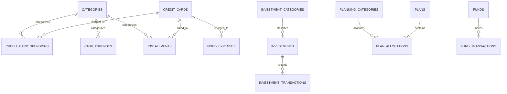

# Mock Data & API Migration Map — Gestão Financeira

> [!IMPORTANT]
> This document catalogs **every location** where the application uses mocked, hardcoded, or static data that will need to be replaced with real API calls when the backend is ready. Use it as a migration checklist.

---

## Table of Contents

- [1. Mock Data Files (Primary Sources)](#1-mock-data-files-primary-sources)
  - [1.1 mockCategories.js](#11-mockcategoriesjs)
  - [1.2 mockExpenses.js](#12-mockexpensesjs)
  - [1.3 mockInvestments.js](#13-mockinvestmentsjs)
  - [1.4 mockPlans.js](#14-mockplansjs)
  - [1.5 mockFunds.js](#15-mockfundsjs)
- [2. Context Initialization (State Hydration Point)](#2-context-initialization-state-hydration-point)
- [3. Inline Hardcoded Data in Pages](#3-inline-hardcoded-data-in-pages)
- [4. Client-Side ID Generation](#4-client-side-id-generation)
- [5. Static UI Configuration Data](#5-static-ui-configuration-data)
- [6. Entity Relationship Diagram](#6-entity-relationship-diagram)
- [7. Proposed API Endpoints](#7-proposed-api-endpoints)
- [8. Migration Priority Matrix](#8-migration-priority-matrix)
- [9. Migration Strategy Recommendations](#9-migration-strategy-recommendations)

---

## 1. Mock Data Files (Primary Sources)

All primary mock data lives in `features/*/data/` directories and is imported exclusively by [`AppDataContext.jsx`](file:///c:/Projetos/GestaoFinanceira/src/contexts/AppDataContext.jsx).

---

### 1.1 mockCategories.js

**File**: [`src/features/categories/data/mockCategories.js`](file:///c:/Projetos/GestaoFinanceira/src/features/categories/data/mockCategories.js)

#### Exports & Data Shapes

**`mockCategories`** — [Lines 1–13](file:///c:/Projetos/GestaoFinanceira/src/features/categories/data/mockCategories.js#L1-L13) — 11 records

| Field  | Type     | Required | Description                        | Example          |
|:-------|:---------|:---------|:-----------------------------------|:-----------------|
| `id`   | `string` | Yes      | Unique category ID                 | `'cat-1'`        |
| `name` | `string` | Yes      | Display name                       | `'Alimentação'`  |
| `type` | `string` | Yes      | `'expense'` or `'investment'`      | `'expense'`      |

**`mockCreditCards`** — [Lines 14–19](file:///c:/Projetos/GestaoFinanceira/src/features/categories/data/mockCategories.js#L14-L19) — 4 records

| Field         | Type     | Required | Description                    | Example     |
|:--------------|:---------|:---------|:-------------------------------|:------------|
| `id`          | `string` | Yes      | Unique card ID                 | `'cc-1'`    |
| `bankName`    | `string` | Yes      | Bank/issuer label              | `'Nubank'`  |
| `closingDate` | `number` | Yes      | Invoice closing day (1–31)     | `15`        |
| `dueDate`     | `number` | Yes      | Invoice due day (1–31)         | `22`        |

**`mockInvestmentCategories`** — [Lines 21–27](file:///c:/Projetos/GestaoFinanceira/src/features/categories/data/mockCategories.js#L21-L27) — 5 records

| Field  | Type     | Required | Description           | Example        |
|:-------|:---------|:---------|:----------------------|:---------------|
| `id`   | `string` | Yes      | Category ID           | `'icat-1'`     |
| `name` | `string` | Yes      | Asset class name      | `'Renda Fixa'` |

**`mockPlanningCategories`** — [Lines 29–38](file:///c:/Projetos/GestaoFinanceira/src/features/categories/data/mockCategories.js#L29-L38) — 8 records

| Field  | Type     | Required | Description         | Example      |
|:-------|:---------|:---------|:--------------------|:-------------|
| `id`   | `string` | Yes      | Budget category ID  | `'pcat-1'`   |
| `name` | `string` | Yes      | Budget bucket name  | `'Moradia'`  |

#### Consumers

| Consumer File | What It Uses | Purpose |
|:---|:---|:---|
| [`AppDataContext.jsx:6,14-17`](file:///c:/Projetos/GestaoFinanceira/src/contexts/AppDataContext.jsx#L6) | All 4 exports | State initialization |
| [`CategoriesPage.jsx:23`](file:///c:/Projetos/GestaoFinanceira/src/features/categories/pages/CategoriesPage.jsx#L23) | All 4 entities | CRUD management UI |
| [`CreditCardSpendings.jsx:17`](file:///c:/Projetos/GestaoFinanceira/src/features/expenses/pages/CreditCardSpendings.jsx#L17) | `categories`, `creditCards` | Form dropdowns, card summaries |
| [`CashExpenses.jsx:18`](file:///c:/Projetos/GestaoFinanceira/src/features/expenses/pages/CashExpenses.jsx#L18) | `categories` | Category dropdown (type = expense) |
| [`Installments.jsx:16`](file:///c:/Projetos/GestaoFinanceira/src/features/expenses/pages/Installments.jsx#L16) | `categories`, `creditCards` | Form dropdowns |
| [`FixedExpenses.jsx:16`](file:///c:/Projetos/GestaoFinanceira/src/features/expenses/pages/FixedExpenses.jsx#L16) | `creditCards` | Card assignment dropdown, grouping |
| [`InvestmentsDashboard.jsx:21`](file:///c:/Projetos/GestaoFinanceira/src/features/investments/pages/InvestmentsDashboard.jsx#L21) | `investmentCategories` | Category dropdown, badges |
| [`InvestmentDetails.jsx:21`](file:///c:/Projetos/GestaoFinanceira/src/features/investments/pages/InvestmentDetails.jsx#L21) | `investmentCategories` | Category badge |
| [`MonthlyPlanningPage.jsx:15`](file:///c:/Projetos/GestaoFinanceira/src/features/planning/pages/MonthlyPlanningPage.jsx#L15) | `planningCategories` | Allocation labels, new category creation |
| [`UnifiedDashboard.jsx:18`](file:///c:/Projetos/GestaoFinanceira/src/features/dashboard/pages/UnifiedDashboard.jsx#L18) | `categories`, `planningCategories` | Charts and planning summary |
| [`ExpensesDashboard.jsx:13`](file:///c:/Projetos/GestaoFinanceira/src/features/expenses/pages/ExpensesDashboard.jsx#L13) | `categories` (via `getCategoryName`) | Chart labels |

---

### 1.2 mockExpenses.js

**File**: [`src/features/expenses/data/mockExpenses.js`](file:///c:/Projetos/GestaoFinanceira/src/features/expenses/data/mockExpenses.js)

#### Exports & Data Shapes

**`mockCreditCardSpendings`** — [Lines 1–18](file:///c:/Projetos/GestaoFinanceira/src/features/expenses/data/mockExpenses.js#L1-L18) — 14 records

| Field          | Type     | Required | Description                     | Example              |
|:---------------|:---------|:---------|:--------------------------------|:---------------------|
| `id`           | `string` | Yes      | Unique spending ID              | `'ccs-1'`            |
| `value`        | `number` | Yes      | Positive amount spent           | `89.90`              |
| `categoryId`   | `string` | Yes      | FK → `categories.id`           | `'cat-1'`            |
| `creditCardId` | `string` | Yes      | FK → `creditCards.id`           | `'cc-1'`             |
| `date`         | `string` | Yes      | Transaction date (`YYYY-MM-DD`) | `'2026-05-02'`       |
| `description`  | `string` | Yes      | Merchant / description          | `'iFood - Jantar'`   |

**`mockCashExpenses`** — [Lines 20–37](file:///c:/Projetos/GestaoFinanceira/src/features/expenses/data/mockExpenses.js#L20-L37) — 14 records

| Field         | Type            | Required | Description                                        | Example         |
|:--------------|:----------------|:---------|:---------------------------------------------------|:----------------|
| `id`          | `string`        | Yes      | Unique cash transaction ID                         | `'ce-1'`        |
| `value`       | `number`        | Yes      | Signed: negative = expense, positive = income      | `-1200.00`      |
| `categoryId`  | `string\|null`  | No       | FK → `categories.id` (null for income)             | `'cat-6'`       |
| `bank`        | `string`        | Yes      | Bank / account name                                | `'Nubank'`      |
| `date`        | `string`        | Yes      | Transaction date (`YYYY-MM-DD`)                    | `'2026-05-01'`  |
| `description` | `string`        | Yes      | Description                                        | `'Aluguel'`     |

> [!NOTE]
> **Sign convention**: Cash expenses use negative values for outflows and positive for inflows (salary, freelance). Selectors like `getCashExpenseTotal` explicitly filter `value < 0` and use `Math.abs()`.

**`mockInstallments`** — [Lines 39–48](file:///c:/Projetos/GestaoFinanceira/src/features/expenses/data/mockExpenses.js#L39-L48) — 7 records

| Field                | Type     | Required | Description                           | Example             |
|:---------------------|:---------|:---------|:--------------------------------------|:--------------------|
| `id`                 | `string` | Yes      | Unique installment ID                 | `'inst-1'`          |
| `value`              | `number` | Yes      | Monthly installment charge            | `250.00`            |
| `categoryId`         | `string` | Yes      | FK → `categories.id`                  | `'cat-7'`           |
| `creditCardId`       | `string` | Yes      | FK → `creditCards.id`                 | `'cc-1'`            |
| `month`              | `string` | Yes      | Billing month (`YYYY-MM`)             | `'2026-05'`         |
| `description`        | `string` | Yes      | Purchase description                  | `'Notebook Dell'`   |
| `totalInstallments`  | `number` | Yes      | Total installment count               | `12`                |
| `currentInstallment` | `number` | Yes      | Current installment (1-based)         | `3`                 |

> [!NOTE]
> Installments are individual records scoped per month. There is **no automatic generation** of the next month's installment record. Each month's entry must exist independently.

**`mockFixedExpenses`** — [Lines 50–57](file:///c:/Projetos/GestaoFinanceira/src/features/expenses/data/mockExpenses.js#L50-L57) — 6 records

| Field          | Type     | Required | Description               | Example              |
|:---------------|:---------|:---------|:--------------------------|:---------------------|
| `id`           | `string` | Yes      | Unique fixed expense ID   | `'fe-1'`             |
| `value`        | `number` | Yes      | Monthly recurring charge  | `14.90`              |
| `description`  | `string` | Yes      | Service name              | `'Spotify Premium'`  |
| `creditCardId` | `string` | Yes      | FK → `creditCards.id`     | `'cc-1'`             |

#### Consumers

| Consumer File | Entities Used | Purpose |
|:---|:---|:---|
| [`AppDataContext.jsx:7,18-21`](file:///c:/Projetos/GestaoFinanceira/src/contexts/AppDataContext.jsx#L7) | All 4 exports | State initialization |
| [`CreditCardSpendings.jsx`](file:///c:/Projetos/GestaoFinanceira/src/features/expenses/pages/CreditCardSpendings.jsx) | `creditCardSpendings` | CRUD table, card subtotals |
| [`CashExpenses.jsx`](file:///c:/Projetos/GestaoFinanceira/src/features/expenses/pages/CashExpenses.jsx) | `cashExpenses` | CRUD table, bank balances |
| [`Installments.jsx`](file:///c:/Projetos/GestaoFinanceira/src/features/expenses/pages/Installments.jsx) | `installments` | CRUD table, progress bars |
| [`FixedExpenses.jsx`](file:///c:/Projetos/GestaoFinanceira/src/features/expenses/pages/FixedExpenses.jsx) | `fixedExpenses` | CRUD table, card grouping |
| [`ExpensesDashboard.jsx`](file:///c:/Projetos/GestaoFinanceira/src/features/expenses/pages/ExpensesDashboard.jsx) | All 4 via selectors | KPI cards, charts |
| [`UnifiedDashboard.jsx`](file:///c:/Projetos/GestaoFinanceira/src/features/dashboard/pages/UnifiedDashboard.jsx) | All 4 via selectors | KPI cards, charts, planning |
| [`MonthlyPlanningPage.jsx`](file:///c:/Projetos/GestaoFinanceira/src/features/planning/pages/MonthlyPlanningPage.jsx) | All 4 via selectors | Actual vs planned comparison |

---

### 1.3 mockInvestments.js

**File**: [`src/features/investments/data/mockInvestments.js`](file:///c:/Projetos/GestaoFinanceira/src/features/investments/data/mockInvestments.js)

#### Exports & Data Shapes

**`mockInvestments`** — [Lines 1–7](file:///c:/Projetos/GestaoFinanceira/src/features/investments/data/mockInvestments.js#L1-L7) — 5 records

| Field                  | Type     | Required | Description             | Example                       |
|:-----------------------|:---------|:---------|:------------------------|:------------------------------|
| `id`                   | `string` | Yes      | Unique investment ID    | `'inv-1'`                     |
| `value`                | `number` | Yes      | Initial investment      | `15000.00`                    |
| `date`                 | `string` | Yes      | Inception date          | `'2025-06-15'`                |
| `investmentCategoryId` | `string` | Yes      | FK → `investmentCategories.id` | `'icat-1'`             |
| `description`          | `string` | Yes      | Asset title             | `'CDB Banco Inter 110% CDI'` |

**`mockInvestmentTransactions`** — [Lines 9–27](file:///c:/Projetos/GestaoFinanceira/src/features/investments/data/mockInvestments.js#L9-L27) — 12 records

| Field          | Type     | Required | Description                                            | Example       |
|:---------------|:---------|:---------|:-------------------------------------------------------|:--------------|
| `id`           | `string` | Yes      | Unique transaction ID                                  | `'it-1'`      |
| `type`         | `string` | Yes      | `'deposit'` \| `'withdrawal'` \| `'rentability'`       | `'deposit'`   |
| `value`        | `number` | Yes      | Amount (can be negative for negative rentability)      | `10000.00`    |
| `date`         | `string` | Yes      | Transaction date (`YYYY-MM-DD`)                        | `'2025-06-15'`|
| `investmentId` | `string` | Yes      | FK → `investments.id`                                  | `'inv-1'`     |

#### Consumers

| Consumer File | Entities Used | Purpose |
|:---|:---|:---|
| [`AppDataContext.jsx:8,22-23`](file:///c:/Projetos/GestaoFinanceira/src/contexts/AppDataContext.jsx#L8) | Both exports | State initialization |
| [`InvestmentsDashboard.jsx`](file:///c:/Projetos/GestaoFinanceira/src/features/investments/pages/InvestmentsDashboard.jsx) | Both | Portfolio KPIs, table, area chart, create modal |
| [`InvestmentDetails.jsx`](file:///c:/Projetos/GestaoFinanceira/src/features/investments/pages/InvestmentDetails.jsx) | Both | Detail view, transaction ledger |
| [`UnifiedDashboard.jsx`](file:///c:/Projetos/GestaoFinanceira/src/features/dashboard/pages/UnifiedDashboard.jsx) | Via `getTotalInvestmentValue` | KPI card, area chart |

---

### 1.4 mockPlans.js

**File**: [`src/features/planning/data/mockPlans.js`](file:///c:/Projetos/GestaoFinanceira/src/features/planning/data/mockPlans.js)

#### Exports & Data Shapes

**`mockPlans`** — [Lines 1–32](file:///c:/Projetos/GestaoFinanceira/src/features/planning/data/mockPlans.js#L1-L32) — 2 records

| Field        | Type                     | Required | Description              | Example      |
|:-------------|:-------------------------|:---------|:-------------------------|:-------------|
| `id`         | `string`                 | Yes      | Unique plan ID           | `'plan-1'`   |
| `month`      | `string`                 | Yes      | Target month (`YYYY-MM`) | `'2026-05'`  |
| `income`     | `number`                 | Yes      | Expected income          | `7500.00`    |
| `categories` | `Array<CategoryAlloc>`   | Yes      | Budget allocations       | *(below)*    |

**Nested `CategoryAllocation`**:

| Field                | Type     | Required | Description              | Example     |
|:---------------------|:---------|:---------|:-------------------------|:------------|
| `planningCategoryId` | `string` | Yes      | FK → `planningCategories.id` | `'pcat-1'` |
| `allocatedValue`     | `number` | Yes      | Budgeted amount          | `1500.00`   |

#### Consumers

| Consumer File | Purpose |
|:---|:---|
| [`AppDataContext.jsx:10,26`](file:///c:/Projetos/GestaoFinanceira/src/contexts/AppDataContext.jsx#L10) | State initialization |
| [`MonthlyPlanningPage.jsx`](file:///c:/Projetos/GestaoFinanceira/src/features/planning/pages/MonthlyPlanningPage.jsx) | Budget editing, allocation management |
| [`UnifiedDashboard.jsx`](file:///c:/Projetos/GestaoFinanceira/src/features/dashboard/pages/UnifiedDashboard.jsx) | Surplus/deficit KPI, planning progress bar |

---

### 1.5 mockFunds.js

**File**: [`src/features/stored-money/data/mockFunds.js`](file:///c:/Projetos/GestaoFinanceira/src/features/stored-money/data/mockFunds.js)

#### Exports & Data Shapes

**`mockFunds`** — [Lines 1–7](file:///c:/Projetos/GestaoFinanceira/src/features/stored-money/data/mockFunds.js#L1-L7) — 5 records

| Field         | Type     | Required | Description         | Example                    |
|:--------------|:---------|:---------|:--------------------|:---------------------------|
| `id`          | `string` | Yes      | Unique fund ID      | `'fund-1'`                 |
| `totalValue`  | `number` | Yes      | Current balance     | `12000.00`                 |
| `description` | `string` | Yes      | Goal name           | `'Reserva de Emergência'`  |

**`mockFundTransactions`** — [Lines 8–20](file:///c:/Projetos/GestaoFinanceira/src/features/stored-money/data/mockFunds.js#L8-L20) — 11 records

| Field    | Type     | Required | Description                       | Example        |
|:---------|:---------|:---------|:----------------------------------|:---------------|
| `id`     | `string` | Yes      | Unique transaction ID             | `'ft-1'`       |
| `type`   | `string` | Yes      | `'add'` \| `'withdraw'`           | `'add'`        |
| `value`  | `number` | Yes      | Positive amount                   | `1000.00`      |
| `fundId` | `string` | Yes      | FK → `funds.id`                   | `'fund-1'`     |
| `date`   | `string` | Yes      | Transaction date (`YYYY-MM-DD`)   | `'2026-05-05'` |

#### Consumers

| Consumer File | Purpose |
|:---|:---|
| [`AppDataContext.jsx:9,24-25`](file:///c:/Projetos/GestaoFinanceira/src/contexts/AppDataContext.jsx#L9) | State initialization |
| [`StoredMoneyDashboard.jsx`](file:///c:/Projetos/GestaoFinanceira/src/features/stored-money/pages/StoredMoneyDashboard.jsx) | Fund cards, transactions, CRUD |
| [`UnifiedDashboard.jsx`](file:///c:/Projetos/GestaoFinanceira/src/features/dashboard/pages/UnifiedDashboard.jsx) | KPI card via `getTotalStoredMoney` |

---

## 2. Context Initialization (State Hydration Point)

> [!IMPORTANT]
> **This is the single integration point** where the backend API will replace mock data. All mock files feed into the [`initialState`](file:///c:/Projetos/GestaoFinanceira/src/contexts/AppDataContext.jsx#L13-L27) object inside `AppDataContext.jsx`.

**File**: [`src/contexts/AppDataContext.jsx`](file:///c:/Projetos/GestaoFinanceira/src/contexts/AppDataContext.jsx)

```
Lines 5–10: Mock imports
Lines 13–27: initialState object populated from mocks
Line 86: useReducer(appReducer, initialState)
Line 87: selectedMonth via useState(format(new Date(), 'yyyy-MM'))
```

| State Key                | Mock Source               | Record Count |
|:-------------------------|:--------------------------|:-------------|
| `categories`             | `mockCategories`          | 11           |
| `creditCards`             | `mockCreditCards`         | 4            |
| `investmentCategories`    | `mockInvestmentCategories`| 5            |
| `planningCategories`      | `mockPlanningCategories`  | 8            |
| `creditCardSpendings`     | `mockCreditCardSpendings` | 14           |
| `cashExpenses`            | `mockCashExpenses`        | 14           |
| `installments`            | `mockInstallments`        | 7            |
| `fixedExpenses`           | `mockFixedExpenses`       | 6            |
| `investments`             | `mockInvestments`         | 5            |
| `investmentTransactions`  | `mockInvestmentTransactions` | 12        |
| `funds`                   | `mockFunds`               | 5            |
| `fundTransactions`        | `mockFundTransactions`    | 11           |
| `plans`                   | `mockPlans`               | 2            |

**Total: 13 entity collections, 104 mock records**

---

## 3. Inline Hardcoded Data in Pages

These are **not** in mock data files — they are hardcoded directly inside page components and will also need API replacements.

### 3.1 Historical Investment Trend Data

> [!WARNING]
> This data is **duplicated** in two separate files with identical hardcoded values.

**Location 1**: [`UnifiedDashboard.jsx:71-77`](file:///c:/Projetos/GestaoFinanceira/src/features/dashboard/pages/UnifiedDashboard.jsx#L71-L77)
**Location 2**: [`InvestmentsDashboard.jsx:48`](file:///c:/Projetos/GestaoFinanceira/src/features/investments/pages/InvestmentsDashboard.jsx#L48)

```javascript
const investTrend = [
  { month: 'Jan', value: 28000 },
  { month: 'Fev', value: 29500 },
  { month: 'Mar', value: 31000 },
  { month: 'Abr', value: 32200 },
  { month: 'Mai', value: investmentTotal },  // Only this is dynamic
];
```

**Required API**: `GET /api/investments/history?range=6m` — monthly portfolio snapshots.

---

### 3.2 KPI Trend Percentages (Static Fake Deltas)

**Location**: [`UnifiedDashboard.jsx:97-115`](file:///c:/Projetos/GestaoFinanceira/src/features/dashboard/pages/UnifiedDashboard.jsx#L97-L115)

| KPI Card              | Hardcoded Trend | Hardcoded Label       | Line |
|:----------------------|:----------------|:----------------------|:-----|
| Despesas do Mês       | `trend={-5.2}`  | `"vs. mês anterior"`  | [L97](file:///c:/Projetos/GestaoFinanceira/src/features/dashboard/pages/UnifiedDashboard.jsx#L97) |
| Investimentos         | `trend={3.8}`   | `"rentabilidade"`     | [L105](file:///c:/Projetos/GestaoFinanceira/src/features/dashboard/pages/UnifiedDashboard.jsx#L105) |
| Dinheiro Guardado     | `trend={8.5}`   | `"vs. mês anterior"`  | [L113](file:///c:/Projetos/GestaoFinanceira/src/features/dashboard/pages/UnifiedDashboard.jsx#L113) |

**Required API**: `GET /api/dashboard/kpis?month=YYYY-MM` — month-over-month comparison deltas.

---

### 3.3 Transaction History Display Limit

**Location**: [`StoredMoneyDashboard.jsx:55`](file:///c:/Projetos/GestaoFinanceira/src/features/stored-money/pages/StoredMoneyDashboard.jsx#L55)

The fund cards show only the 3 most recent transactions (hardcoded `.slice(0, 3)`). This is a UI-level decision but may need to become configurable or paginated with API support.

---

## 4. Client-Side ID Generation

**Location**: [`src/utils/helpers.js:33-35`](file:///c:/Projetos/GestaoFinanceira/src/utils/helpers.js#L33-L35)

```javascript
export function generateId() {
  return crypto.randomUUID();
}
```

**Used in**:
- [`AppDataContext.jsx:36`](file:///c:/Projetos/GestaoFinanceira/src/contexts/AppDataContext.jsx#L36) — Generic `ADD_*` reducer handler
- [`AppDataContext.jsx:73`](file:///c:/Projetos/GestaoFinanceira/src/contexts/AppDataContext.jsx#L73) — `ADD_FUND_TRANSACTION` handler
- [`InvestmentsDashboard.jsx:56`](file:///c:/Projetos/GestaoFinanceira/src/features/investments/pages/InvestmentsDashboard.jsx#L56) — Pre-generates ID for dual-dispatch (create investment + initial deposit)

> [!CAUTION]
> **Bug**: In [`InvestmentsDashboard.jsx:55-59`](file:///c:/Projetos/GestaoFinanceira/src/features/investments/pages/InvestmentsDashboard.jsx#L55-L59), a `newId` is generated client-side and sent in the `ADD_INVESTMENTS` payload, but the generic reducer handler at [`AppDataContext.jsx:36`](file:///c:/Projetos/GestaoFinanceira/src/contexts/AppDataContext.jsx#L36) **overwrites** it with `generateId()`. This means the initial deposit transaction's `investmentId` won't match the actual investment ID in state.

**Migration note**: When moving to a backend, IDs will be generated server-side. The `generateId()` utility and client-side ID management will be removed entirely.

---

## 5. Static UI Configuration Data

These are hardcoded configuration values that are **not** mock data but may evolve into configurable settings or localization resources:

| Data | Location | Description |
|:---|:---|:---|
| `pageTitles` map | [`Header.jsx:5-16`](file:///c:/Projetos/GestaoFinanceira/src/components/layout/Header.jsx#L5-L16) | Route → page title mapping (10 entries) |
| `navigation` structure | [`Sidebar.jsx:26-63`](file:///c:/Projetos/GestaoFinanceira/src/components/layout/Sidebar.jsx#L26-L63) | Sidebar menu items with icons, paths, children |
| `MONTHS_PT` array | [`MonthPicker.jsx:7-10`](file:///c:/Projetos/GestaoFinanceira/src/components/ui/MonthPicker.jsx#L7-L10) | 12 month abbreviations in pt-BR |
| `CHART_COLORS` | [`UnifiedDashboard.jsx:11`](file:///c:/Projetos/GestaoFinanceira/src/features/dashboard/pages/UnifiedDashboard.jsx#L11) | 6 hex color palette |
| `COLORS` | [`ExpensesDashboard.jsx:9`](file:///c:/Projetos/GestaoFinanceira/src/features/expenses/pages/ExpensesDashboard.jsx#L9) | 8 hex color palette |
| `COLORS` | [`MonthlyPlanningPage.jsx:12`](file:///c:/Projetos/GestaoFinanceira/src/features/planning/pages/MonthlyPlanningPage.jsx#L12) | Chart colors |
| `typeLabels` / `typeColors` | [`InvestmentDetails.jsx:15-16`](file:///c:/Projetos/GestaoFinanceira/src/features/investments/pages/InvestmentDetails.jsx#L15-L16) | Transaction type display labels and badge colors |
| `tabList` | [`CategoriesPage.jsx:15-20`](file:///c:/Projetos/GestaoFinanceira/src/features/categories/pages/CategoriesPage.jsx#L15-L20) | Tab definitions for category management |
| Notification bell dot | [`Sidebar.jsx:195`](file:///c:/Projetos/GestaoFinanceira/src/components/layout/Sidebar.jsx#L195) | Static unread indicator (always visible) |
| User profile placeholder | [`Sidebar.jsx:198-200`](file:///c:/Projetos/GestaoFinanceira/src/components/layout/Sidebar.jsx#L198-L200) | Static avatar circle |

---

## 6. Entity Relationship Diagram



---

## 7. Proposed API Endpoints

### Authentication & Session

| Method | Endpoint | Replaces | Notes |
|:-------|:---------|:---------|:------|
| `POST` | `/api/auth/register` | User sign-up | Returns JWT `{ accessToken, expiresInSeconds, userId, email }`, sets `gf_refresh` cookie |
| `POST` | `/api/auth/login` | User sign-in | Validates credentials (Argon2id), returns JWT, sets `gf_refresh` cookie |
| `POST` | `/api/auth/refresh` | Token rotation | Requires `credentials: 'include'` and header `X-Requested-With: GestaoFinanceira` |
| `POST` | `/api/auth/logout` | Session termination | Clears `gf_refresh` cookie and revokes token family |
| `GET` | `/api/auth/me` | User profile / session check | Requires `Authorization: Bearer <token>` |

> [!NOTE]
> All endpoints below require `Authorization: Bearer <accessToken>`. Pre-seeded test records are owned by Demo User (`demo@gestaofinanceira.local` / `DemoPassword123!`).

### Categories & Accounts

| Method | Endpoint | Replaces | Notes |
|:-------|:---------|:---------|:------|
| `GET` | `/api/categories` | `mockCategories` | Query param `?type=expense\|investment` |
| `POST` | `/api/categories` | `ADD_CATEGORIES` | |
| `PUT` | `/api/categories/:id` | `UPDATE_CATEGORIES` | |
| `DELETE` | `/api/categories/:id` | `DELETE_CATEGORIES` | Cascade-check child transactions |
| `GET` | `/api/credit-cards` | `mockCreditCards` | |
| `POST` | `/api/credit-cards` | `ADD_CREDITCARDS` | |
| `PUT` | `/api/credit-cards/:id` | `UPDATE_CREDITCARDS` | |
| `DELETE` | `/api/credit-cards/:id` | `DELETE_CREDITCARDS` | Cascade-check spendings, installments, fixed |
| `GET` | `/api/investment-categories` | `mockInvestmentCategories` | |
| `POST` | `/api/investment-categories` | `ADD_INVESTMENTCATEGORIES` | |
| `PUT` | `/api/investment-categories/:id` | `UPDATE_INVESTMENTCATEGORIES` | |
| `DELETE` | `/api/investment-categories/:id` | `DELETE_INVESTMENTCATEGORIES` | |
| `GET` | `/api/planning-categories` | `mockPlanningCategories` | |
| `POST` | `/api/planning-categories` | `ADD_PLANNINGCATEGORIES` | |
| `PUT` | `/api/planning-categories/:id` | `UPDATE_PLANNINGCATEGORIES` | |
| `DELETE` | `/api/planning-categories/:id` | `DELETE_PLANNINGCATEGORIES` | |

### Expenses

| Method | Endpoint | Replaces | Notes |
|:-------|:---------|:---------|:------|
| `GET` | `/api/expenses/credit-card?month=YYYY-MM&cardId=:id` | `mockCreditCardSpendings` | Month + card filtering |
| `POST` | `/api/expenses/credit-card` | `ADD_CREDITCARDSPENDINGS` | |
| `PUT` | `/api/expenses/credit-card/:id` | `UPDATE_CREDITCARDSPENDINGS` | |
| `DELETE` | `/api/expenses/credit-card/:id` | `DELETE_CREDITCARDSPENDINGS` | |
| `GET` | `/api/expenses/cash?month=YYYY-MM&bank=:name` | `mockCashExpenses` | Month + bank filtering |
| `POST` | `/api/expenses/cash` | `ADD_CASHEXPENSES` | |
| `PUT` | `/api/expenses/cash/:id` | `UPDATE_CASHEXPENSES` | |
| `DELETE` | `/api/expenses/cash/:id` | `DELETE_CASHEXPENSES` | |
| `GET` | `/api/expenses/cash/balances` | `getBankBalances()` | Computed aggregation |
| `GET` | `/api/expenses/installments?month=YYYY-MM` | `mockInstallments` | |
| `POST` | `/api/expenses/installments` | `ADD_INSTALLMENTS` | |
| `PUT` | `/api/expenses/installments/:id` | `UPDATE_INSTALLMENTS` | |
| `DELETE` | `/api/expenses/installments/:id` | `DELETE_INSTALLMENTS` | |
| `GET` | `/api/expenses/fixed` | `mockFixedExpenses` | No month scope (recurring) |
| `POST` | `/api/expenses/fixed` | `ADD_FIXEDEXPENSES` | |
| `PUT` | `/api/expenses/fixed/:id` | `UPDATE_FIXEDEXPENSES` | |
| `DELETE` | `/api/expenses/fixed/:id` | `DELETE_FIXEDEXPENSES` | |

### Investments

| Method | Endpoint | Replaces | Notes |
|:-------|:---------|:---------|:------|
| `GET` | `/api/investments` | `mockInvestments` | |
| `GET` | `/api/investments/:id` | Find by ID | |
| `POST` | `/api/investments` | `ADD_INVESTMENTS` | Server creates initial deposit tx |
| `PUT` | `/api/investments/:id` | `UPDATE_INVESTMENTS` | |
| `DELETE` | `/api/investments/:id` | `DELETE_INVESTMENTS` | Cascade-delete transactions |
| `GET` | `/api/investments/:id/transactions` | `mockInvestmentTransactions` (filtered) | |
| `POST` | `/api/investments/:id/transactions` | `ADD_INVESTMENTTRANSACTIONS` | |
| `DELETE` | `/api/investments/transactions/:id` | `DELETE_INVESTMENTTRANSACTIONS` | |
| `GET` | `/api/investments/history?range=6m` | Hardcoded trend arrays | Monthly portfolio snapshots |

### Stored Money / Funds

| Method | Endpoint | Replaces | Notes |
|:-------|:---------|:---------|:------|
| `GET` | `/api/funds` | `mockFunds` | |
| `POST` | `/api/funds` | `ADD_FUNDS` | |
| `PUT` | `/api/funds/:id` | `UPDATE_FUNDS` | |
| `DELETE` | `/api/funds/:id` | `DELETE_FUNDS` | Cascade-delete transactions |
| `GET` | `/api/funds/:id/transactions` | `mockFundTransactions` (filtered) | |
| `POST` | `/api/funds/:id/transactions` | `ADD_FUND_TRANSACTION` | Server updates fund balance |

### Planning

| Method | Endpoint | Replaces | Notes |
|:-------|:---------|:---------|:------|
| `GET` | `/api/plans?month=YYYY-MM` | `mockPlans` (filtered) | |
| `POST` | `/api/plans` | `ADD_PLANS` | |
| `PUT` | `/api/plans/:id` | `UPDATE_PLANS` | Includes allocation updates |
| `DELETE` | `/api/plans/:id` | `DELETE_PLANS` | |

### Dashboard Aggregation

| Method | Endpoint | Replaces | Notes |
|:-------|:---------|:---------|:------|
| `GET` | `/api/dashboard/kpis?month=YYYY-MM` | Hardcoded trend percentages | Month-over-month comparison |
| `GET` | `/api/dashboard/expenses-by-category?month=YYYY-MM` | Client-side category aggregation | Server-side aggregation |
| `GET` | `/api/dashboard/expenses-by-type?month=YYYY-MM` | Client-side type aggregation | Server-side aggregation |

---

## 8. Migration Priority Matrix

| Priority | Category | Items | Rationale |
|:---------|:---------|:------|:----------|
| 🔴 **P0** | **State Initialization** | [`AppDataContext.jsx:5-27,86`](file:///c:/Projetos/GestaoFinanceira/src/contexts/AppDataContext.jsx#L5-L27) | Single entry point; replace `initialState` with API fetch on mount |
| 🔴 **P0** | **CRUD Dispatchers** | All 13 entity reducer cases | Replace with API calls + optimistic UI or refetch |
| 🟠 **P1** | **Inline Trend Data** | `UnifiedDashboard:71-77`, `InvestmentsDashboard:48` | Cannot compute real history without backend |
| 🟠 **P1** | **KPI Trend Deltas** | `UnifiedDashboard:97-115` | Requires month-over-month comparison endpoint |
| 🟡 **P2** | **ID Generation** | `helpers.js:33-35` | Server-side IDs eliminate the dual-dispatch bug |
| 🟢 **P3** | **Static UI Config** | Navigation, page titles, colors | Optional: keep client-side or make configurable |

---

## 9. Migration Strategy Recommendations

> [!TIP]
> The architecture is well-suited for incremental migration. Because all mock data flows through a single `AppDataContext`, you can replace one entity at a time.

### Recommended Approach

1. **Authentication & Session Interceptor**:
   - Establish authentication state in React (e.g. `AuthContext.jsx` holding access token in memory).
   - Configure HTTP client (`fetch` wrapper or `axios` instance) with:
     - `credentials: 'include'` to send `gf_refresh` HttpOnly cookie.
     - Automatic injection of `Authorization: Bearer <accessToken>`.
     - Automatic injection of `X-Requested-With: GestaoFinanceira` on `/refresh` and `/logout` calls.
     - 401 response interceptor: attempts silent rotation via `POST /api/auth/refresh`, updates memory token, and retries original request once. If refresh fails, redirect to login.
   - For rapid development/demoing, sign in using default credentials:
     - **Email**: `demo@gestaofinanceira.local`
     - **Password**: `DemoPassword123!`
2. **Create an API service layer** (`src/services/api.js`) with typed endpoints for each domain module.
3. **Replace `initialState`** with empty arrays and add `useEffect` in `AppDataProvider` to fetch initial data on mount (once authenticated).
4. **Replace `dispatch` calls** in feature pages with API calls followed by context state updates (optimistic updates or refetch patterns).
5. **Add loading and error states** to the context (currently none exist).
6. **Remove mock data files** once all entities are migrated.
7. **Replace inline hardcoded data** (trends, KPI deltas) with API-driven aggregations (`/api/dashboard/kpis`, `/api/dashboard/expenses-by-category`, etc.).
8. **Fix the ID generation bug** — let PostgreSQL generate canonical GUIDs.

### Files to Modify (Ordered)

1. `src/contexts/AuthContext.jsx` — **[NEW]** Authentication provider, token storage, login/logout/refresh logic
2. `src/services/api.js` — **[NEW]** API service client with auth token interceptor and CSRF header
3. `src/contexts/AppDataContext.jsx` — Replace mock imports, add fetch logic, add loading/error states
4. Each feature page — Replace `dispatch()` calls with API service calls
5. `src/features/*/data/mock*.js` — **[DELETE]** all 5 mock files
6. `src/utils/helpers.js` — Remove `generateId()` once server handles IDs
