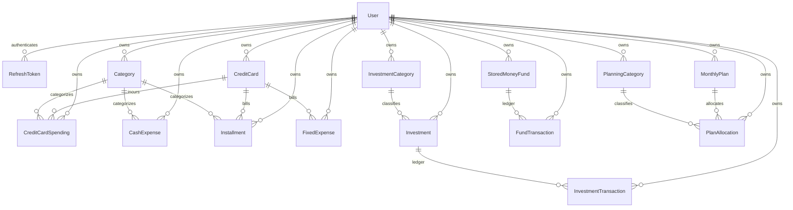

# Backend Architecture & Domain Blueprint — Gestão Financeira API

## 1. Overview & Purpose

This document provides an exhaustive, authoritative blueprint of the **Gestão Financeira API** backend as currently implemented. It details the architectural paradigms, domain modeling decisions, database strategies, and business invariants governing the system. 

It is designed to serve as the onboarding foundation for any engineer or AI coding agent joining this project, and as the baseline for the future **System Constitution**.

---

## 2. Architectural Paradigm: Clean Architecture & Repository Pattern

The solution is implemented on **.NET 10** following **Clean Architecture (Onion / Hexagonal Architecture)** principles, ensuring strict separation of concerns, framework independence, and testability.

```
                           ┌──────────────────────────────┐
                           │      UI: Web API Layer       │
                           │ (Controllers, Swagger, CORS, │
                           │  JWT Middleware, Auth Cookies│
                           └──────────────┬───────────────┘
                                          │
                  ┌───────────────────────┴───────────────────────┐
                  │                                               │
   ┌──────────────▼───────────────┐               ┌───────────────▼──────────────┐
   │     Persistence Infra        │               │       Security Infra         │
   │ (EF Core, PostgreSQL, Npgsql)│               │ (Argon2id, JWT Tokens, Auth) │
   └──────────────┬───────────────┘               └───────────────┬──────────────┘
                  │                                               │
                  └───────────────────────┬───────────────────────┘
                                          │
                           ┌──────────────▼───────────────┐
                           │      Application Layer       │
                           │  (Services, DTOs, Contracts) │
                           └──────────────┬───────────────┘
                                          │
                           ┌──────────────▼───────────────┐
                           │      Domain Entities Layer   │
                           │   (Entities, Enums, Guards)  │
                           └──────────────────────────────┘
```

### 2.1 Project Structure & Dependency Flow

The solution ([`GerenciamentoFinanceiro.sln`](file:///c:/Projetos/GestaoFinanceira.API/GerenciamentoFinanceiro.sln)) contains five production projects, one unit test suite, and one regression test suite:

1. **`GerenciamentoFinanceiro.Entities` (Domain Core)**:
   - Contains 16 rich domain entities (including [`User`](file:///c:/Projetos/GestaoFinanceira.API/src/Domain/GerenciamentoFinanceiro.Entities/Entities/User.cs) and [`RefreshToken`](file:///c:/Projetos/GestaoFinanceira.API/src/Domain/GerenciamentoFinanceiro.Entities/Entities/RefreshToken.cs)), 3 domain enums, and the [`IUserOwnedEntity`](file:///c:/Projetos/GestaoFinanceira.API/src/Domain/GerenciamentoFinanceiro.Entities/Entities/IUserOwnedEntity.cs) tenant marker interface.
   - **Zero external dependencies**: Contains pure C# code; no Entity Framework, no ASP.NET, no third-party libraries.
   - Enforces business invariants and data integrity directly through constructors and domain methods.

2. **`GerenciamentoFinanceiro.Application` (Business & Orchestration)**:
   - Contains Application Services (`AuthService`, `ExpenseService`, `InvestmentService`, `StoredMoneyService`, `PlanningService`, `CategoryService`, `DashboardService`).
   - Declares 16 repository and security contracts (`IUserRepository`, `IRefreshTokenRepository`, `IPasswordHasher`, `ITokenService`, `ICurrentUserService`, `ICategoryRepository`, etc.).
   - Contains immutable DTOs (`record` types) organized by domain module.
   - Depends **only** on `GerenciamentoFinanceiro.Entities`.

3. **`GerenciamentoFinanceiro.Security` (Cryptographic & Token Infrastructure)**:
   - Implements `IPasswordHasher` via OWASP-recommended **Argon2id** (19 MiB memory, 2 iterations, 1 parallelism, 16-byte random per-user salt).
   - Implements `ITokenService` via `Microsoft.IdentityModel.JsonWebTokens` (HMAC-SHA256, strictly containing only `sub = userId` in user claims).
   - Depends on `GerenciamentoFinanceiro.Application`.

4. **`GerenciamentoFinanceiro.PostgreSQL` (Persistence & Infrastructure)**:
   - Implements repository interfaces using **Entity Framework Core 10** and **Npgsql**.
   - Contains `FinanceDbContext`, entity type configurations with `UserId` foreign keys, and EF Core migrations.
   - **Dedicated Schema (`finance`)**: All 16 tables are mapped to the `finance` schema (`modelBuilder.HasDefaultSchema("finance")`), isolating application data and preventing public exposure on Supabase PostgREST.
   - **Primary Key Defaults**: All 16 tables configure `.HasDefaultValueSql("gen_random_uuid()")` ensuring primary keys are functional both via EF Core and direct SQL inserts.
   - **Integrity Constraints**: Enforces `ON DELETE RESTRICT` on all Category and CreditCard foreign references, `ON DELETE SET NULL` on `RefreshToken.ReplacedByTokenId`, and `ON DELETE CASCADE` from `Users(Id)` to tenant entities.
   - **Multi-Tenant Composite Indexes**: Implements composite indexes (`(UserId, Date)`, `(UserId, Month)`, `(UserId, Bank)`, `(UserId, Type)`) matching Global Query Filter query access patterns.
   - Enforces automatic tenant isolation via Global Query Filters on all 14 user-owned tables and stamps `UserId` automatically in `SaveChangesAsync`.
   - Depends on `GerenciamentoFinanceiro.Application` and `GerenciamentoFinanceiro.Entities`.

5. **`GerenciamentoFinanceiro.API` (Presentation & HTTP Delivery)**:
   - ASP.NET Core Web API host with 10 RESTful controllers, JWT Bearer authentication, HttpOnly refresh cookie management, CSRF validation, Swagger/OpenAPI 10 configuration, CORS policies, and program entry point ([`Program.cs`](file:///c:/Projetos/GestaoFinanceira.API/src/UI/GerenciamentoFinanceiro.API/Program.cs)).
   - References `GerenciamentoFinanceiro.Application`, `GerenciamentoFinanceiro.PostgreSQL`, and `GerenciamentoFinanceiro.Security`.

6. **`GerenciamentoFinanceiro.UnitTests` (Isolated Application Unit Tests)**:
   - High-speed in-memory unit tests validating business rules, calculations, balance rollbacks, and multi-tenancy invariants.

7. **`GerenciamentoFinanceiro.RegressionTests` (Automated Black-Box Verification)**:
   - HTTP regression test suite built with **xUnit** and `HttpClient`, testing real API endpoints against the running PostgreSQL backend. Includes comprehensive `AuthTests`, `RefreshTokenTests`, and `TenantIsolationTests`.

---

## 3. Domain Entity Modeling & Business Rationale

The business domain is partitioned into an Identity & Session core plus four financial domains and cross-cutting categorization:



### 3.0 Identity & Session Domain

- **[`User`](file:///c:/Projetos/GestaoFinanceira.API/src/Domain/GerenciamentoFinanceiro.Entities/Entities/User.cs)**:
  - **Fields**: `Id` (Guid), `Email` (string), `PasswordHash` (string), `CreatedAt` (DateTime).
  - **Business Decision**: Acts as the root tenant anchor for every single financial record in the system. Enforces RFC-compliant email normalization (`email.Trim().ToLowerInvariant()`).
- **[`RefreshToken`](file:///c:/Projetos/GestaoFinanceira.API/src/Domain/GerenciamentoFinanceiro.Entities/Entities/RefreshToken.cs)**:
  - **Fields**: `Id` (Guid), `TokenHash` (string SHA-256), `UserId` (Guid), `FamilyId` (Guid), `ExpiresAt` (DateTime), `CreatedAt` (DateTime), `RevokedAt` (DateTime?), `ReplacedByTokenId` (Guid?).
  - **Foreign Key**: `ReplacedByTokenId` links via a self-referencing foreign key to `RefreshTokens(Id)` (`ON DELETE SET NULL`), indexed via `IX_RefreshTokens_ReplacedByTokenId`.
  - **Business Invariant**: Implements token family rotation. If an already-revoked or already-replaced token hash is presented during refresh, the system flags token reuse (theft) and immediately revokes all tokens within that `FamilyId`.

### 3.1 Categorization & Account Entities

- **[`Category`](file:///c:/Projetos/GestaoFinanceira.API/src/Domain/GerenciamentoFinanceiro.Entities/Entities/Category.cs)**:
  - **Fields**: `Id` (Guid), `Name` (string), `Type` (`CategoryType`: `Expense`, `Investment`).
  - **Business Decision**: Categorizes everyday transactional expenses (and general asset categories). Filterable by type so dropdowns only show relevant transaction categories.
- **[`CreditCard`](file:///c:/Projetos/GestaoFinanceira.API/src/Domain/GerenciamentoFinanceiro.Entities/Entities/CreditCard.cs)**:
  - **Fields**: `Id` (Guid), `BankName` (string), `ClosingDate` (int 1-31), `DueDate` (int 1-31).
  - **Business Decision**: Models physical or virtual credit cards. Closing and due days are stored as integers to calculate billing cycles and cutoff dates for credit charges.
- **[`InvestmentCategory`](file:///c:/Projetos/GestaoFinanceira.API/src/Domain/GerenciamentoFinanceiro.Entities/Entities/InvestmentCategory.cs)**:
  - **Fields**: `Id` (Guid), `Name` (string).
  - **Business Decision**: Distinct asset class labels (e.g., *"Renda Fixa"*, *"Ações"*, *"FIIs"*, *"Cripto"*). Kept separate from transactional categories.
- **[`PlanningCategory`](file:///c:/Projetos/GestaoFinanceira.API/src/Domain/GerenciamentoFinanceiro.Entities/Entities/PlanningCategory.cs)**:
  - **Fields**: `Id` (Guid), `Name` (string).
  - **Critical Architectural Decision**: **Strictly isolated from transactional categories**. Planning categories represent macro budget buckets (e.g., *"Moradia"*, *"Alimentação"*, *"Lazer"*, *"Investimentos"*), whereas transactional categories represent micro operational entries (e.g., *"Supermercado"*, *"Padaria"*, *"iFood"*, *"Farmácia"*). Blending them creates data pollution and breaks budget projections.

---

### 3.2 Expenses Domain

The expense tracking engine segregates spending by payment rail:

1. **[`CreditCardSpending`](file:///c:/Projetos/GestaoFinanceira.API/src/Domain/GerenciamentoFinanceiro.Entities/Entities/CreditCardSpending.cs)**:
   - Direct, one-off charges to a credit card.
   - Foreign Keys: `CategoryId`, `CreditCardId`.
   - Fields: `Value`, `Date`, `Description`.
2. **[`CashExpense`](file:///c:/Projetos/GestaoFinanceira.API/src/Domain/GerenciamentoFinanceiro.Entities/Entities/CashExpense.cs)**:
   - PIX, Boleto, cash inflows (income), and direct debit transactions.
   - Fields: `Value`, `CategoryId` (Guid? nullable), `Bank`, `Date`, `Description`.
   - **Business Decision**: Supports signed transactions (positive amounts for income inflows, negative amounts for expenses). When recording income inflows, `CategoryId` is optional (`null`), allowing unassigned general income while tracking net bank balances per financial institution. All category foreign references enforce `ON DELETE RESTRICT`.
3. **[`Installment`](file:///c:/Projetos/GestaoFinanceira.API/src/Domain/GerenciamentoFinanceiro.Entities/Entities/Installment.cs)**:
   - Represents a specific monthly portion of a multi-part card charge (*"Parcelas"*).
   - Fields: `Value`, `CategoryId`, `CreditCardId`, `Month` (DateTime), `Description`, `TotalInstallments` (int), `CurrentInstallment` (int).
   - **Business Decision**: Installments are stored as **independent monthly records** rather than being dynamically generated on the fly. This guarantees historic immutability: past statements do not shift if card parameters change, and individual installment adjustments can be made without altering future installments.
4. **[`FixedExpense`](file:///c:/Projetos/GestaoFinanceira.API/src/Domain/GerenciamentoFinanceiro.Entities/Entities/FixedExpense.cs)**:
   - Represents recurring subscriptions or static recurring monthly fees (e.g., *"Netflix"*, *"Spotify"*, *"Smart Fit"*).
   - Fields: `Value`, `Description`, `CreditCardId`.
   - **Business Decision**: Linked directly to a `CreditCard` because these represent automated card billing. They recur every billing cycle without needing manual monthly re-entry.

---

### 3.3 Investments Domain

- **[`Investment`](file:///c:/Projetos/GestaoFinanceira.API/src/Domain/GerenciamentoFinanceiro.Entities/Entities/Investment.cs)**:
  - Represents an asset position or portfolio allocation.
  - Fields: `Value`, `Date`, `InvestmentCategoryId`.
- **[`InvestmentTransaction`](file:///c:/Projetos/GestaoFinanceira.API/src/Domain/GerenciamentoFinanceiro.Entities/Entities/InvestmentTransaction.cs)**:
  - Ledger tracking financial movements on an investment.
  - Types (`InvestmentTransactionType`): `Deposit`, `Withdrawal`, `Rentability`.
  - **Business Decision**: The `Value` on the `Investment` represents the live asset valuation. Deposits increase `Value`, withdrawals decrease `Value`, and user-triggered `Rentability` updates represent capital appreciation or earnings without external cash injections.

---

### 3.4 Stored Money (Savings Funds) Domain

- **[`StoredMoneyFund`](file:///c:/Projetos/GestaoFinanceira.API/src/Domain/GerenciamentoFinanceiro.Entities/Entities/StoredMoneyFund.cs)**:
  - Target savings accounts (e.g., *"Reserva de Emergência"*, *"Viagem"*, *"Troca de Carro"*).
  - Fields: `TotalValue`, `Description`.
- **[`FundTransaction`](file:///c:/Projetos/GestaoFinanceira.API/src/Domain/GerenciamentoFinanceiro.Entities/Entities/FundTransaction.cs)**:
  - Ledger record for funds.
  - Types (`FundTransactionType`): `Add`, `Withdraw`.
  - **Business Invariant**: `StoredMoneyFund.Withdraw(amount)` strictly prevents overdrafts by throwing an `InvalidOperationException` if `amount > TotalValue`. A fund's balance can never fall below zero.

---

### 3.5 Monthly Planning Domain

- **[`MonthlyPlan`](file:///c:/Projetos/GestaoFinanceira.API/src/Domain/GerenciamentoFinanceiro.Entities/Entities/MonthlyPlan.cs)**:
  - Registered per month with an expected `Income` (e.g., R$ 10.500,00).
  - Unique index enforces **one plan per month**.
- **[`PlanAllocation`](file:///c:/Projetos/GestaoFinanceira.API/src/Domain/GerenciamentoFinanceiro.Entities/Entities/PlanAllocation.cs)**:
  - Assigns a monetary target to a `PlanningCategory` for a specific month.
  - Composite unique index enforces **one allocation per planning category per monthly plan** `(MonthlyPlanId, PlanningCategoryId)`.
- **Dynamic Business Calculations**:
  - `TotalAllocated` = $\sum \text{AllocatedValue}$ across all allocations for the plan.
  - `Surplus` = $\text{Income} - \text{TotalAllocated}$. Indicates unallocated income or budgetary deficit.

---

### 3.6 Cross-Cutting Analytics (Dashboard)

The [`DashboardService`](file:///c:/Projetos/GestaoFinanceira.API/src/Domain/GerenciamentoFinanceiro.Application/Services/DashboardService.cs) aggregates financial health across all domains:
1. **High-Level KPIs**:
   - Total Monthly Expenses (Sum of Card Spendings + Cash Expenses + Installments + Fixed Expenses).
   - Month-over-Month Expense Trend %: $\frac{\text{CurrentMonth} - \text{PreviousMonth}}{\text{PreviousMonth}} \times 100$.
   - Total Investments Valuation & Monthly Rentability %.
   - Total Stored Money (Savings) & Net MoM Growth %.
   - Monthly Planning Budget Surplus.
2. **Category & Type Segregation**:
   - Expenses grouped descending by category with relative percentage.
   - Expenses segregated by payment rail (Credit Card, PIX/Cash, Installments, Fixed).

---

## 4. Engineering Standards & Design Conventions

Future developers and AI coding agents working on this codebase must adhere strictly to the following standards:

### 4.1 Encapsulation & Rich Domain Modeling
- **Private Setters**: All entity properties must have `private set`. Never expose public property setters on domain entities.
- **Invariant Enforcement in Constructors**: All entities must validate their parameters in constructors (`ArgumentException` for non-positive numbers, empty GUIDs, or null/whitespace strings).
- **Domain Methods for Mutations**: State transitions must occur via explicit domain methods (e.g., `fund.Deposit(amount)`, `fund.Withdraw(amount)`, `investment.ApplyRentability(earnings)`).

### 4.2 Monetary Precision Standard
- **Mandatory Type**: All monetary amounts, prices, fees, and calculations **must use `decimal`**.
- **Prohibited Types**: Never use `double` or `float` for financial values.
- **Database Precision**: Configured in PostgreSQL via EF Core as `HasPrecision(18, 2)`.

### 4.3 DTO Immutability & Segregation
- DTOs are declared as C# `record` types in `GerenciamentoFinanceiro.Application.DTOs`.
- Read DTOs (`*Dto`) and Write DTOs (`Create*Dto`, `Update*Dto`) must remain separate.
- DTOs must never contain database entity references or EF Core navigation properties.

### 4.4 Repository Contracts, Persistence & Query Sargability Rules
- Repositories must inherit from dedicated interfaces declared in `GerenciamentoFinanceiro.Application.Interfaces`.
- **Read Operations**: All repository read queries must use `.AsNoTracking()` to avoid EF Core change tracking overhead.
- **Asynchronous I/O**: All repository and service methods must be fully asynchronous (`async Task<T>`), utilizing EF Core async extensions (`ToListAsync`, `FirstOrDefaultAsync`, `SumAsync`).
- **Query Sargability & B-Tree Index Utilization**:
  - Never write non-sargable LINQ constructs against date or timestamp properties (e.g., prohibited: `.Where(x => x.Month.Year == y && x.Month.Month == m)` or `.Where(x => x.Date.Year == y)`), which force PostgreSQL to invoke `EXTRACT(...)` and bypass B-Tree indexes.
  - Always write sargable range comparisons:
    ```csharp
    var startOfMonth = new DateTime(year, month, 1);
    var endOfMonth = startOfMonth.AddMonths(1);
    query = query.Where(x => x.Date >= startOfMonth && x.Date < endOfMonth);
    ```
  - This allows the PostgreSQL query planner to perform fast B-Tree range scans on composite tenant indexes like `(UserId, Date)` or `(UserId, Month)`.

### 4.5 Database Schema, Keys & Referential Integrity
- **Schema Isolation**: All application domain tables reside in the `finance` schema (never `public`).
- **Server-Side Primary Key Generation**: Every table's `Id` column must configure `HasDefaultValueSql("gen_random_uuid()")` to guarantee functional identity generation during direct SQL scripts and EF Core operations alike.
- **Referential Delete Rules**:
  - Domain entity relationships (e.g., transactions to categories or credit cards) must enforce `DeleteBehavior.Restrict` (`ON DELETE RESTRICT`) to protect financial history from accidental orphan deletion.
  - Multi-tenant ownership links from `Users(Id)` must enforce `DeleteBehavior.Cascade` (`ON DELETE CASCADE`).
  - Pointer references like `RefreshToken.ReplacedByTokenId` must enforce `DeleteBehavior.SetNull` (`ON DELETE SET NULL`).

### 4.6 Controller Design
- Controllers must remain **thin orchestrators**. Controllers only parse HTTP parameters, invoke the appropriate Application Service, and return structured `ActionResult<T>`.
- Business rules, calculations, and entity instantiations must **never** live inside controllers.

### 4.7 RESTful HTTP Status Standards
- `200 OK`: Successful retrieval or synchronous update.
- `201 Created`: Successful creation, accompanied by `CreatedAtAction(nameof(GetById), ...)` and response body.
- `204 NoContent`: Successful deletion.
- `400 Bad Request`: Validation failure or invalid parameter payload.
- `404 Not Found`: Resource with specified GUID does not exist.

---

## 5. Principles for the Future System Constitution

When the formal **System Constitution** is ratified for the Gestão Financeira project, the following core tenets must be enshrined:

| Principle # | Name | Constitutional Rule |
| :---: | :--- | :--- |
| **I** | **The Monolith of Truth** | All financial values and calculations served by the API must originate from verifiable records in PostgreSQL. Synthetic or simulated curves are prohibited. |
| **II** | **Zero Framework Domain** | The `GerenciamentoFinanceiro.Entities` project must never take dependencies on any external NuGet package, ORM, or presentation library. |
| **III** | **Monetary Integrity** | Financial calculations must use 128-bit decimal arithmetic (`decimal(18,2)`). Rounding must follow standard banker's rounding (`MidpointRounding.ToEven`) or explicit two-decimal truncation. |
| **IV** | **No Negative Savings** | Savings funds (`StoredMoneyFund`) must strictly disallow negative balances. Any transaction causing an overdraft must be rejected. |
| **V** | **Categorical Independence** | Budget planning categories (`PlanningCategory`) must never be combined or merged with transaction categories (`Category`). |
| **VI** | **Ledger Reciprocity** | Any operation that alters an aggregate balance (`Investment`, `StoredMoneyFund`) must be paired with an immutable ledger entry (`InvestmentTransaction`, `FundTransaction`). Deleting a ledger entry must atomically reverse its balance effect. |
| **VII** | **Zero Plaintext Credentials** | Passwords must never be stored, logged, or serialized in plaintext. Passwords must be hashed using OWASP-grade Argon2id ($m=19456, t=2, p=1$) with a unique 16-byte cryptographically secure random salt per user. |
| **VIII** | **Absolute Tenant Isolation** | All business entities must implement `IUserOwnedEntity`. Multi-tenancy must be enforced unconditionally via EF Core Global Query Filters on read, automatic owner stamping on insert, and cross-reference validation in application services. Cross-tenant reads and mutations must strictly return 404 Not Found to prevent tenant enumeration. |
| **IX** | **Schema Isolation & Sargability** | All domain tables must reside in the dedicated `finance` schema with `gen_random_uuid()` server-side defaults. Repository queries must remain strictly index-sargable (using date ranges rather than `DateTime.Year`/`Month` function extraction). |
